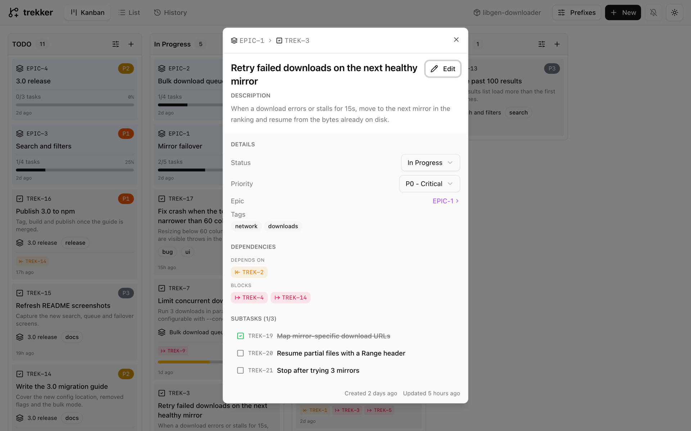
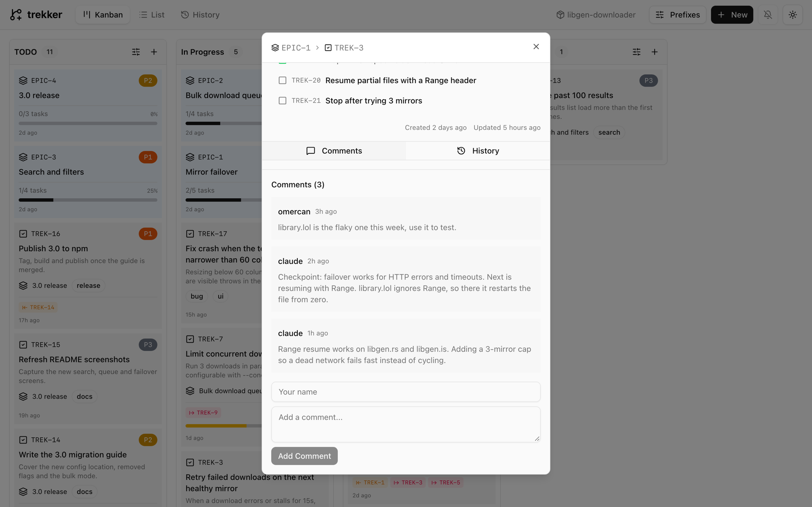
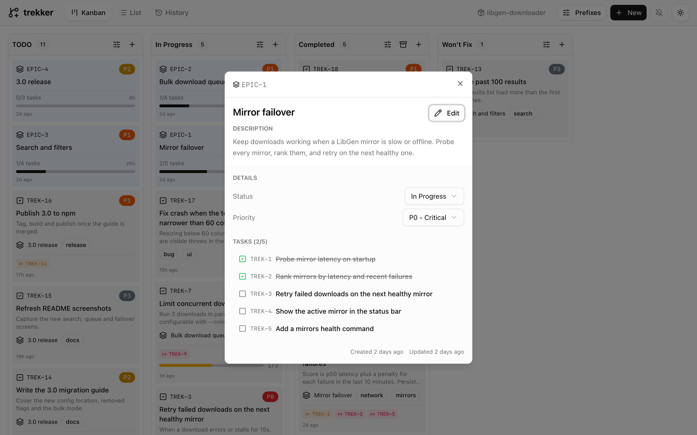
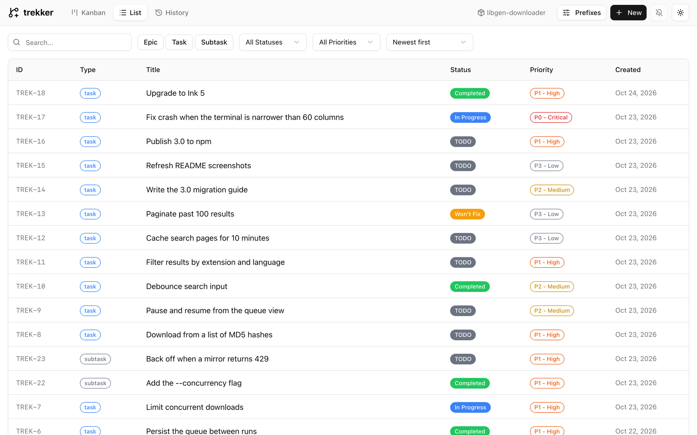
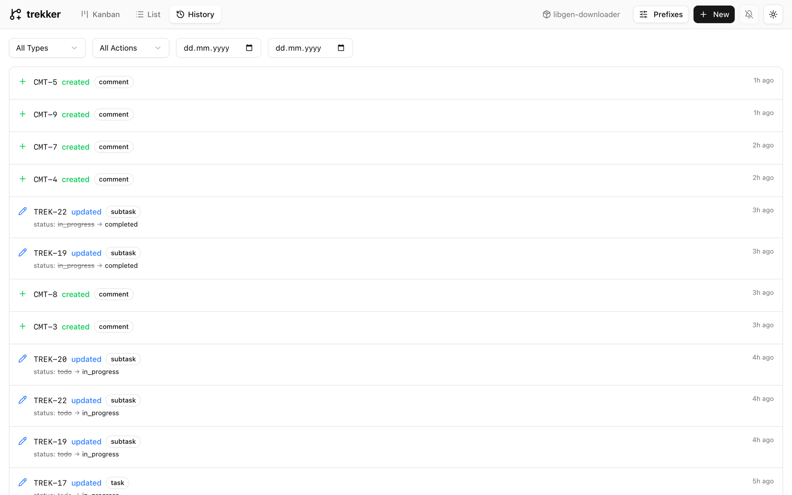

# Trekker Dashboard

> [!IMPORTANT]
> This project has moved into the Trekker CLI and is no longer maintained. Install [`@obsfx/trekker`](https://www.npmjs.com/package/@obsfx/trekker) 1.12.0 or later and run `trekker serve`. It opens the same board on the same `.trekker/trekker.db`, with nothing else to install. This repository is archived and the `@obsfx/trekker-dashboard` npm package is deprecated.

A kanban board for [Trekker](https://github.com/obsfx/trekker). It reads the same `.trekker/trekker.db` the CLI writes and updates live, so you can watch your agents move tasks around while they work.

<picture>
  <source media="(prefers-color-scheme: dark)" srcset="assets/screenshots/dark-kanban.webp">
  
</picture>

## Install

The dashboard runs on [Bun](https://bun.sh), so install Bun first, even if you use npm:

```bash
curl -fsSL https://bun.sh/install | bash
bun install -g @obsfx/trekker-dashboard    # or: npm install -g @obsfx/trekker-dashboard
```

## Usage

Run it in a project that has a `.trekker` folder:

```bash
cd your-project
trekker-dashboard            # http://localhost:3000
trekker-dashboard -p 8080    # pick another port
```

## What's in it

- **Kanban.** Columns for todo, in progress, completed, and won't fix. Epics show how many of their tasks are done, and cards show tags, dependencies, and subtask progress. Each column has its own filters, and the completed column can archive everything in it at once.
- **Task and epic details.** Change status and priority, edit text and tags, and see what a task depends on, what it blocks, and its subtasks. Comments and the task's history sit in tabs underneath.
- **List.** Every epic, task, and subtask in one table, with search, type, status, and priority filters and sorting.
- **History.** Every create, update, and delete, with the fields that changed. Filter by type, action, and date.
- **Live updates.** Changes from the CLI show up right away, as a toast and, if you turn on the bell, a desktop notification.
- **Prefixes.** Change the project's task, epic, and comment ID prefixes. Existing IDs keep theirs.
- Light and dark themes.

<details>
<summary>More screenshots</summary>

<br>

Task detail

<picture>
  <source media="(prefers-color-scheme: dark)" srcset="assets/screenshots/dark-task.webp">
  
</picture>

Comments

<picture>
  <source media="(prefers-color-scheme: dark)" srcset="assets/screenshots/dark-comments.webp">
  
</picture>

Epic

<picture>
  <source media="(prefers-color-scheme: dark)" srcset="assets/screenshots/dark-epic.webp">
  
</picture>

List

<picture>
  <source media="(prefers-color-scheme: dark)" srcset="assets/screenshots/dark-list.webp">
  
</picture>

History

<picture>
  <source media="(prefers-color-scheme: dark)" srcset="assets/screenshots/dark-history.webp">
  
</picture>

</details>

## How it works

The dashboard is a small Bun server with a React front end. It opens the project's SQLite database directly, the same file the `trekker` CLI uses, and pushes changes to the browser over server-sent events. The CLI and the dashboard can write at the same time; writes wait for each other instead of failing.

## Development

```bash
bun install
bun run dev                  # Vite on :5173 and the API server, against ./.trekker/trekker.db
bun run check                # lint, format, typecheck
bun run test                 # server API tests
bun run test:e2e:docker      # Playwright suite in Docker
```

The server tests drive the real CLI from a [trekker](https://github.com/obsfx/trekker) checkout next to this one (`../trekker`).

To release, run `bun run release <patch|minor|major>` (add `--dry-run` to rehearse), then `git push --atomic origin HEAD vX.Y.Z`. The script reinstalls dependencies from the lockfile, runs the checks and tests, bumps the version, builds, publishes to npm, and tags.

## License

MIT
